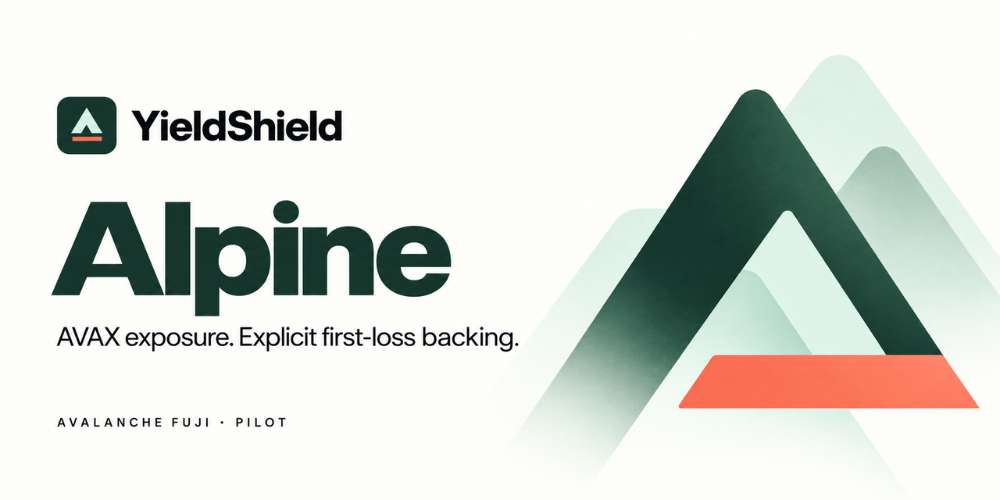

# YieldShield Alpine

Split-risk markets on Avalanche Fuji: holders protect AVAX exposure against separately funded first-loss backing, capital providers earn a share of realized gains, and every reserve, exit and fee is enforced and visible onchain.

**Live demo:** https://avalanche.yieldshield.ai (Avalanche Fuji testnet, valueless test assets). **License:** [MIT](LICENSE).

> Testnet only and unaudited. No asset here has monetary value; aDEMO is not USDC, and awAVAX is not canonical WAVAX. Do not use this code with real funds.

## Status — 12 October 2026

**Fuji contracts are deployed and verified.** Deployment `fuji-2026-10-12T18-48-56Z-8bd0c9` (26 transactions from commit `64f4a13`) passed `npm run verify:fuji`, and the website enables writes against it. A second test account completed a 19-transaction Fuji journey ([report](docs/E2E_REPORT.md#fuji-e2e-12-october-2026), [evidence](docs/evidence/fuji-e2e.json)). Featured markets accept protection until 11 November 2026 and are then replaced. Local test-chain evidence is not Fuji activity. No external investment, independent audit, mainnet readiness or real adoption is claimed.

The implemented catalog contains three protected assets and two backing choices:

| Token | Role | Decimals | Actual backing |
|---|---|---:|---|
| Fuji AVAX | Native protection and exchange asset; gas |18| Native test-network asset |
| awAVAX | Wrapped protection and exchange asset |18| 1:1 deposited Fuji AVAX; **not canonical WAVAX** |
| vaDEMO | Protected vault receipts; exchange asset |18| ERC-4626 claims on aDEMO actually held by its vault |
| aDEMO | Junior backing and exchange settlement |6| Valueless faucet token; **not USDC or dollar redeemable** |
| bvaDEMO | Selectable vault-receipt junior backing |6| Separate funded ERC-4626 aDEMO vault |

sAVAX and Circle USDC remain researched references, not active integrations. No new YieldShield governance token is required.

## Product workflows

- Discover five featured markets, inspect terms and create a custom market with approved asset/backing pairs. Creation atomically credits the 500-backing-unit seed to its creator as provider shares.
- Review a holder deposit, then manage partial/full asset or backing exits, transfer ownership, settle matured positions and claim segregated backing credit.
- Provide capital, request/cancel withdrawal notice, redeem a proportional backing/asset basket, and independently claim earned gain fees. Creator/protocol fees are also pulled separately.
- Buy or sell against actually funded exchange inventory with 0.3% fees, maximum spend/minimum proceeds and deadlines. Purchase confirmation carries the exact asset and amount into protection.
- Wrap/unwrap AVAX and deposit/redeem both funded vaults with output limits. Faucet and funding detours retain the intended role, market and amount.
- Inspect portfolio, local transaction history, exact token identities, network status and a clearly labeled scenario calculator.

All pages have direct URLs, including `/protect`, `/provide`, `/markets`, `/pools/:key`, `/positions`, `/positions/:pool:id`, `/trade`, `/create-pool`, `/portfolio`, `/activity`, `/faucet`, `/assets`, `/status`, `/how-it-works` and `/legal`. Browser Back/Forward and fresh deep links are supported.

## Material economic differences

Provider entry/redemption **freezes while any protected position remains open**, preventing unrealized-loss NAV arbitrage. A finite, immutable epoch bounds this freeze: anyone can settle each remaining position after maturity. Forced settlement surrenders the remaining asset and its upside for the fixed entry-backing claim. Featured markets use the 30-day maximum epoch; factory-created epochs allow 1–30 days. Matured markets are shown as closed and need replacements. Notice does not guarantee immediate liquidity.

Partial exits preserve the proportional entry basis of the remaining position. Fees apply only to positive gains on the withdrawn slice. Rewards, creator/protocol fees, surrendered principal and unclaimed backing are separately accounted. A vault-backed floor is a fixed number of bvaDEMO receipts; the underlying aDEMO redeemable for those receipts can change. There is no fixed dollar guarantee or promised yield.

## Deployed contracts (Fuji, chain 43113)

| Contract | Address |
|---|---|
| Factory | [`0x9764…1875`](https://testnet.snowtrace.io/address/0x97644e8cc3037d26cbe7341dca464383b4011875) |
| Exchange | [`0x680e…598c`](https://testnet.snowtrace.io/address/0x680e68bab322ca20ffd9d5a030596a052d8e598c) |
| aDEMO (faucet backing) | [`0xf5b4…645d`](https://testnet.snowtrace.io/address/0xf5b40cf00980e23a6bf345907624dde104a5645d) |
| awAVAX (wrapped Fuji AVAX) | [`0x4d4d…51f4`](https://testnet.snowtrace.io/address/0x4d4d51e698c31c32e1a94155c9c71950dcce51f4) |
| vaDEMO vault | [`0xe66f…dfee`](https://testnet.snowtrace.io/address/0xe66ff5809959357b4daa6aa4fbe5d93db3a9dfee) |
| bvaDEMO backing vault | [`0x4dd6…5bf6`](https://testnet.snowtrace.io/address/0x4dd6195c1fee539d5eeff2dd5e241279895e5bf6) |
| Reference AVAX market | [`0x394F…72a4`](https://testnet.snowtrace.io/address/0x394Fe51cb12F82a45612d5BF6E79B895a6C372a4) |
| Scenario AVAX market | [`0xB9C1…2b2d`](https://testnet.snowtrace.io/address/0xB9C1ad7d679c512721C3C001c4c8A69697AC2b2d) |
| Wrapped AVAX market | [`0xBc4f…d2Cd`](https://testnet.snowtrace.io/address/0xBc4fC5F631CC1E59375B4BC101f33DB402Fdd2Cd) |
| Vault-receipt market | [`0x855C…c8F3`](https://testnet.snowtrace.io/address/0x855C8f71C2798f1271F1c685554180e19D3ac8F3) |
| AVAX / bvaDEMO market | [`0xC400…c9aF`](https://testnet.snowtrace.io/address/0xC400e83A96D5878Aa0Af91C4E518E83f8aF5c9aF) |
| Chainlink AVAX/USD feed (external) | [`0x5498…06aD`](https://testnet.snowtrace.io/address/0x5498BB86BC934c8D34FDA08E81D444153d0D06aD) |

Every address, transaction hash and the source commit are recorded in [config/deployment.json](config/deployment.json).

## Run and verify

Requirements: Node.js 22+ and [Foundry](https://getfoundry.sh) (`forge` for the Solidity tests, `anvil` for local journeys).

```sh
npm ci --ignore-scripts
npm run dev                 # development server at 127.0.0.1:5181, reading the live Fuji deployment
npm run build               # static output: dist/
npm test                    # JavaScript unit tests
npm run test:contracts      # Solidity tests, including fuzz cases
npm run test:browser        # public routes, mobile, wallet and context regressions
npm run verify:fuji         # read back the deployment: runtime code, wiring, terms and receipts
```

For local transactions only:

```sh
anvil --host 127.0.0.1 --port 8547 --silent
node scripts/local-journey.mjs --browser-ready
node scripts/local-web.mjs   # isolated local-chain preview at 127.0.0.1:5184
ALPINE_LOCAL_E2E=1 npm run test:browser -- tests/browser/local-lifecycle.spec.ts
```

The local journey confirms 48 transactions and writes source-hash-bound [evidence](docs/evidence/local-journey.json). Its optional browser-ready mode resets the disposable chain after recording evidence and prepares fresh markets. Browser tests use Anvil's publicly known local development accounts through an injected test provider; no private keys are embedded in the app or committed. Production builds cannot enable the local-chain configuration.

Deploying your own copy (`npm run deploy:fuji`, a read-only preflight until `--broadcast`) needs a dedicated Fuji test signer in the ignored `.secrets/` directory; see [operations](docs/OPERATIONS.md). Never use a key that holds real funds.

Further reading: [operations](docs/OPERATIONS.md), [security](docs/SECURITY.md), [end-to-end evidence](docs/E2E_REPORT.md), [research](docs/RESEARCH_AND_SCOPE.md), [hosting](docs/HOSTING.md) and [provenance](docs/PROVENANCE.md).

## Contributing and security

Issues and pull requests are welcome. Please run `npm test`, `npm run test:contracts` and `npm run build` before proposing changes. Report suspected vulnerabilities privately as described in [SECURITY](docs/SECURITY.md), not in public issues.

## License

[MIT](LICENSE), copyright Hawig Ventures UG (haftungsbeschränkt), which develops YieldShield. Independently authored from YieldShield's existing product design. OpenZeppelin, React, React Router, viem and Vite retain their upstream licenses. No credentials, private deployment registry or historical contracts were imported from the other chain projects.
